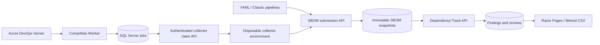

# Architecture

## Processes and trust

`CompAtlas.Web` hosts Windows-authenticated reporting and project-scoped bearer-authenticated machine APIs. It never checks out repositories or starts scanners. `CompAtlas.Worker` discovers repositories, schedules work, imports findings, synchronizes reviews and expires exceptions. `CompAtlas.Collector` reads files or invokes a separately provisioned scanner inside an externally isolated job. A workspace directory or an environment-variable assertion is not a security sandbox.

Use separate Windows service identities for IIS, orchestration and collection. Provision read-only repository/package credentials on disposable collectors. The orchestrator uses a read-only Azure identity plus scoped Dependency-Track permissions. Collectors have neither SQL access nor Dependency-Track credentials.

## Identity and inventories

Collection, project and repository external GUIDs are retained alongside independent CompAtlas IDs. Applications are identified by repository plus normalized relative path; use the same path in central collection and pipelines. Multiple collections are supported. Repository names can change without losing history.

Each submission creates an immutable SBOM snapshot identified by a SHA-256 key over repository, path, revision, branch, build/release IDs and BOM hash. Duplicate uploads return the existing receipt. A repository/application/snapshot maps to a unique Dependency-Track project/version; release BOM evidence is never replaced by a later scan. Current findings are refreshed separately, because new advisories can affect old releases.

Collection coverage and analysis freshness are separate. A successful import only establishes that the supplied inventory was processed. Conservative file inventories are always partial. Package identity/version/license/origin gaps remain findings. Unknown licenses require review even before license policies exist.

## Background jobs

SQL Server jobs have unique deduplication keys, optimistic concurrency revisions, 30-minute leases, three bounded attempts and exponential retry delay. Two orchestration jobs run concurrently by default. Collector jobs are claimed by project-scoped machine identities and bound to a lease owner/credential. A successful collector completion requires submitted inventory for the claimed revision. Collectors must finish within the lease; expired claims cannot complete jobs.

Nightly cycles are identified by UTC date shifted by `NightlyHourUtc`. Discovery reuses a successful inventory for unchanged revisions. Current and retained build/release snapshots are reanalysed daily; the analysis chain token is polled before findings are refreshed.

## Reviews and conflicts

CompAtlas owns human review history and time-limited acceptance. Dependency-Track owns analysis findings. Supported vulnerability assessments are synchronized through durable jobs; license/evidence reviews and exception expiry remain local. Scope is deliberately narrow: acceptance never silently transfers to a new snapshot or another repository.

Review synchronization compares the current upstream assessment with the value observed before the decision. Differences become visible conflicts; superseded local decisions are not written. Dependency-Track does not provide an atomic compare-and-swap endpoint, so provision it read-only for human users during the pilot and make CompAtlas the sole assessment writer. Pending/failed/conflicting synchronization remains visible.

CompAtlas does not suppress findings to represent temporary acceptance. Audit and original SBOM evidence are preserved. Findings refreshed after an advisory change represent current risk, not a historical proof of what the scanner knew at release time.
